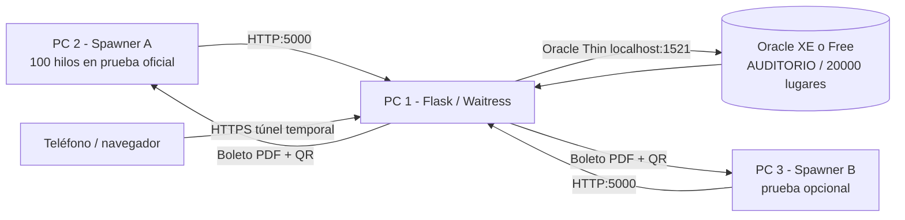
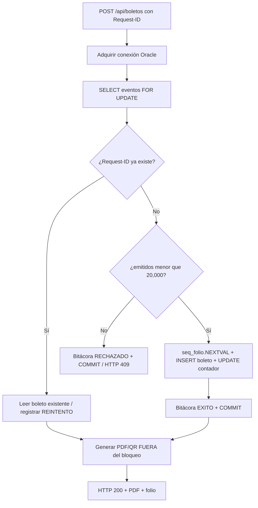
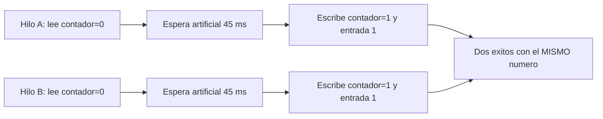

# Diagramas del Concierto Navideño

## 1. Conexiones entre las 3 computadoras

**Conexión simple:** los 3 equipos deben poder acceder a `http://IP_DE_PC1:5000`. Oracle no se instala en PC 2/PC 3 ni expone 1521. Solo PC 1 conoce la contraseña Oracle.

## 2. Sección crítica de emisión real

## 3. Carrera del laboratorio (recurso separado de boletos)

SIN: la lectura y actualización no están protegidas como una operación indivisible. CON: `FOR UPDATE` impide que dos transacciones consulten y asignen el mismo valor simultáneamente.
